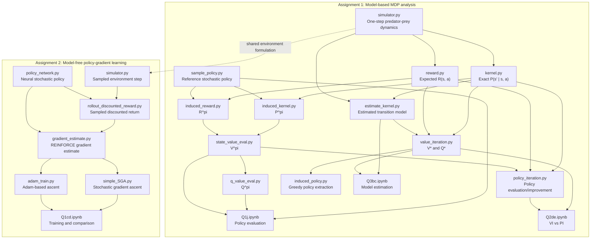

# Grid-World MDP Solver

This repository contains our EE675 work on sequential decision-making in a
predator-prey Grid World. We formulate the environment as a finite Markov
Decision Process (MDP), construct and evaluate its transition and reward
models, compute optimal value functions and policies with dynamic programming,
study model estimation from samples, and finally learn a stochastic policy
directly with policy-gradient methods.

## Repository Dependency Diagram

The diagram below shows how the main functions and notebooks depend on one
another. Assignment 1 is model-based: its solvers use transition and reward
models derived from the simulator. Assignment 2 is model-free: its policy
network interacts with the simulator through sampled rollouts.



## Assignment 1 — Model-Based Grid-World MDP

### Overview

We study a predator-prey process on an `N x N` grid. A state records
the predator and prey locations, and an action specifies the predator's
movement. The simulator applies the movement rules, handles boundary
conditions, samples the prey dynamics, and returns the next state and reward.
This simulator provides the operational definition of the environment used
throughout the assignment.

We use the simulator to build a finite MDP with a transition kernel
`P(s' | s, a)` and expected reward function `R(s, a)`. The resulting
model lets us compare policy evaluation, optimal-control algorithms, and
finite-sample model estimation while keeping the environment dynamics fixed.

### Part 1: Evaluation of a fixed stochastic policy

We first construct the exact transition and reward models from the simulator.
The reference policy assigns action probabilities according to the
distance-minimizing predator strategy, with stochasticity where multiple
actions are equally desirable. We then induce a Markov chain under this policy:

```text
P^pi(s, s') = sum_a pi(a | s) P(s' | s, a)
R^pi(s)      = sum_a pi(a | s) R(s, a)
```

The state-value evaluator solves the discounted Bellman expectation equation
for `V^pi`. The action-value evaluator subsequently derives `Q^pi(s, a)`
from the state values and the original model. We repeat the computation over
several grid sizes and examine both the initial-state value and computational
cost. Because the state contains two grid locations, the state space grows
rapidly with `N`, making the runtime comparison part of the analysis.

The experiment is orchestrated by
[`Assignment1_Q1/Q1j.ipynb`](./Assignment1_Q1/Q1j.ipynb). Its supporting
documentation and implementation details are in
[`Assignment1_Q1/README.md`](./Assignment1_Q1/README.md).

### Part 2: Optimal control with dynamic programming

We next replace the fixed reference policy with an optimal policy. Value
Iteration repeatedly applies the Bellman optimality operator and selects the
highest-valued action at each state. Policy Iteration alternates between
evaluating the current policy and improving it greedily with respect to the
resulting action values.

Both methods operate on the same exact transition and reward models. We compare
their converged value functions and runtime as the grid size changes. Agreement
between the two value functions provides a numerical consistency check, while
the runtime measurements illustrate the different computational costs of
Bellman updates versus nested policy-evaluation and policy-improvement loops.

The comparison is orchestrated by
[`Assignment1_Q2/Q2de.ipynb`](./Assignment1_Q2/Q2de.ipynb), with the algorithm
descriptions in [`Assignment1_Q2/README.md`](./Assignment1_Q2/README.md).

### Part 3: Transition-model estimation from samples

Finally, we assume that the exact transition probabilities are unavailable.
For every state-action pair, we repeatedly sample the simulator and estimate
the transition probabilities by empirical frequencies. The estimated kernel
`P_hat` is then supplied to the value-iteration solver to produce an
estimated action-value function.

We measure the `L1` error between quantities computed with the estimated
model and the corresponding quantities from the exact model. By increasing
the number of samples `K`, we study convergence of the empirical kernel and
the resulting value estimates. Repeating the experiment over multiple random
seeds also exposes estimator variance: increasing `K` should reduce both the
mean error and the spread of the results. The experiment therefore connects
simulation-based model learning with the stability of downstream planning.

The analysis is orchestrated by
[`Assignment1_Q3/Q3bc.ipynb`](./Assignment1_Q3/Q3bc.ipynb), supported by
[`estimate_kernel.py`](./estimate_kernel.py) and the notes in
[`Assignment1_Q3/README.md`](./Assignment1_Q3/README.md).

## Assignment 2 — Policy-Gradient Learning

### Overview

We move from an explicitly known MDP model to direct policy optimization. A
neural network represents a stochastic policy over the predator's actions. The
network receives the concatenated predator and prey coordinates and outputs
action logits. A categorical distribution converts these logits into sampled
actions, allowing the policy to interact with the simulator without requiring
an explicitly constructed transition kernel.

For each episode, we collect the sampled trajectory and compute the discounted
return

```text
G_t = sum_{k=t}^{T-1} gamma^(k-t) r_k
```

The gradient-estimation routine applies the likelihood-ratio, or REINFORCE,
estimator to maximize the expected discounted return. We average estimates over
multiple episodes per training iteration to reduce sampling variance. Training
evaluates the learned policy using additional rollouts, and records both the
objective estimate and the average discounted reward for comparison.

### Optimizers and experimental comparison

We implement two ascent procedures using the same policy architecture and
gradient estimator:

- **Simple stochastic gradient ascent (SGA):** directly updates each network
  parameter in the direction of the estimated policy gradient.
- **Adam-based ascent:** uses PyTorch's Adam optimizer with the gradient sign
  reversed internally so that the optimizer performs maximization rather than
  minimization.

The experiment compares learning curves under these optimizers while keeping
the environment, episode horizon, discount factor, batch size, and evaluation
protocol consistent. This isolates the effect of the optimization rule on
learning speed, reward variability, and final policy performance.

The main experiment is in
[`Assignment2_Policy_Gradient/Q1cd.ipynb`](./Assignment2_Policy_Gradient/Q1cd.ipynb).
The implementation is divided among
[`policy_network.py`](./Assignment2_Policy_Gradient/policy_network.py),
[`gradient_estimate.py`](./Assignment2_Policy_Gradient/gradient_estimate.py),
[`rollout_discounted_reward.py`](./Assignment2_Policy_Gradient/rollout_discounted_reward.py),
[`simple_SGA.py`](./Assignment2_Policy_Gradient/simple_SGA.py), and
[`adam_train.py`](./Assignment2_Policy_Gradient/adam_train.py).

## Project Structure

```text
.
├── Assignment1_Q1/                  # Fixed-policy evaluation
├── Assignment1_Q2/                  # Value Iteration and Policy Iteration
├── Assignment1_Q3/                  # Sampled transition-kernel estimation
├── Assignment2_Policy_Gradient/     # REINFORCE, SGA, and Adam
├── kernel.py                        # Exact MDP transition kernel
├── reward.py                        # Expected reward model
├── simulator.py                     # Grid-World environment dynamics
└── *.pdf                            # Assignment statements and supporting notes
```

## Environment

The notebooks use Python with NumPy and Matplotlib. Assignment 1 also uses
SciPy for sparse computations, while Assignment 2 uses PyTorch for the policy
network and optimization. The notebooks are the primary entry points for
reproducing the reported experiments; each assignment directory contains its
own execution notes and supporting material.